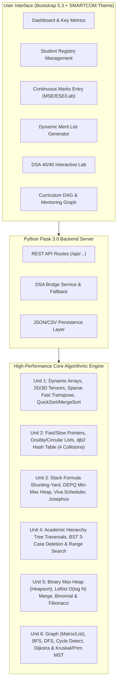

# AcadPulse 🎓
### Student Ranking and Academic Performance Analyser
**Advanced Data Structures Comprehensive Course Project**

[](engine/)
[-success)](docs/SYLLABUS_COVERAGE.md)
[](backend/)
[](frontend/)
[](frontend/)

---

## 📌 Project Problem Statement

> **"2. Student Ranking and Academic Performance Analyser"**  
> *"An educational institution conducts multiple examinations and continuous assessments throughout the semester. The institute requires a system that maintains student records, updates marks whenever assessments are conducted, generates merit lists based on different evaluation criteria, and identifies top-performing students. Develop an application to automate these activities."*

---

## 🏛️ System Architecture



---

## 🚀 Key Features

1. **Continuous Assessment Gradebook**: Updates and tracks marks across Mid-Semester Exams (MSE), End-Semester Exams (ESE), Lab Practicals, and Course Projects.
2. **Dynamic Merit List Generator**: Generates merit rankings based on switchable evaluation criteria tracks (Institutional Standard, Practical/Project Heavy, Theory Focus, or custom user-defined formulas).
3. **Infix-to-Postfix Stack Engine**: Live Shunting-Yard parser that translates arbitrary arithmetic weighting formulas like `(MSE * 0.3) + (ESE * 0.5) + (LAB * 0.2)` into Reverse Polish Notation and evaluates it via a custom stack.
4. **Instant Topper & At-Risk Identification**: Double-Ended Priority Queue (Min-Max Heap) provides simultaneous $O(1)$ lookup for academic toppers (gold medalists) and at-risk students requiring remedial attention.
5. **Interactive DSA Workbench (40/40 Topics)**: Dedicated visualizer tab allowing professors and external examiners to test every single data structure and algorithm live.
6. **Curriculum Prerequisite & Mentoring Graph**: Models degree curriculum dependencies, validates circular locks via 3-color DFS, computes Dijkstra's shortest remedial path, and finds the minimum-cost peer mentoring backbone using Kruskal's/Prim's MST.

---

## 📚 100% Syllabus Coverage Summary

All 40 topics from the Data Structures curriculum are implemented with zero external library dependencies.

| Unit | Syllabus Topics Covered | Core Implementation |
|---|---|---|
| **Unit 1: Arrays** | Asymptotic Notations, Space/Time Complexity, Dynamic Vectors, 2D Row-Major Arrays, 3D Temporal Cubes, Sparse Matrix Simple & Fast Transpose, Merge Sort, Quick Sort (3 Pivots), Insertion Sort | `core/vec.hpp`, `core/array2d.hpp`, `core/array3d.hpp`, `ds/sparse_matrix.hpp`, `algo/sorting.hpp` |
| **Unit 2: Linked Lists & Hashing** | Pointers, Dynamic Memory, Fast & Slow Pointers (Tortoise/Hare), Singly LL, Doubly LL (O(1) deletion), Circular LL, Floyd's Cycle Detection, Polynomial Addition, Hash Table (djb2), 4 Collision Strategies (Chaining, Linear, Quadratic, Double Hash) & Rehashing | `ds/linked_lists.hpp`, `ds/hash_table.hpp` |
| **Unit 3: Stacks & Queues** | Array Stack, Linked Stack, Infix to Postfix Conversion, Postfix Evaluation, Circular Array Queue, Linked Queue, Priority Queue, DEPQ (Min-Max Heap), CPU/Viva Job Scheduling (FCFS, Round Robin), Josephus Elimination | `ds/stack.hpp`, `algo/expressions.hpp`, `ds/queue.hpp`, `ds/depq_minmax.hpp`, `algo/scheduler.hpp`, `algo/josephus.hpp` |
| **Unit 4: Trees** | Binary Tree Hierarchy, Array-based Representation, Recursive & Iterative Traversals (Pre/In/Post/Level-Order), Binary Search Tree (BST) Search, Insert, 3-Case Deletion, Range Query, Balanced Rebuild | `ds/binary_tree.hpp`, `ds/bst.hpp` |
| **Unit 5: Heaps** | Binary Max Heap, Binary Min Heap, In-Place Heapify, Heapsort, Leftist Heap (O(log N) Merge), Binomial Heap (Forest of Trees, Union), Fibonacci Heap (Amortized O(1) Decrease-Key) | `ds/heaps_binary.hpp`, `ds/heap_leftist.hpp`, `ds/heap_binomial.hpp`, `ds/heap_fibonacci.hpp` |
| **Unit 6: Graphs** | Graph Dual Representation (Adjacency Matrix & Adjacency List), BFS & DFS Traversals, Connected Components, 3-Color Cycle Detection, Prim's MST, Kruskal's MST (with Disjoint Set Union / DSU), Dijkstra Shortest Path, Floyd-Warshall All-Pairs | `algo/graph.hpp`, `algo/graph_traversal.hpp`, `algo/mst.hpp`, `ds/dsu.hpp`, `algo/shortest_path.hpp` |

See [docs/SYLLABUS_COVERAGE.md](docs/SYLLABUS_COVERAGE.md) for the complete detailed matrix.

---

## 🛠️ Quick Start & Running Locally

### Prerequisites
- Modern Native Compiler (GCC / Clang)
- Python 3.10+
- pip

### 1. Compile and Run Unit Tests
```bash
# Compile and execute Zero-STL verification suite
make test
./engine/tests/test_all_dsa.exe
```

Expected output:
```
==========================================================
 AcadPulse DSA Core Engine - Zero-STL Verification   
 Covers Comprehensive Data Structures Course Syllabus     
==========================================================
[TEST] 1. Dynamic Vector, Array2D, Array3D... PASSED
[TEST] 2. Sparse Matrix (Simple & Fast Transpose)... PASSED
[TEST] 3. Singly, Doubly, Circular Lists, Floyd's Cycle, Polynomial... PASSED
[TEST] 4. Hash Table (Chaining, Linear, Quadratic, Double Hash)... PASSED
[TEST] 5. Stacks, Circular Queue, Priority Queue, DEPQ (Min-Max Heap)... PASSED
[TEST] 6. Binary Tree Traversals (Rec & Iter) & BST (Insert, 3-Case Delete, Range, Balance)... PASSED
[TEST] 7. Binary Max/Min Heap, Heapsort, Leftist, Binomial, Fibonacci Heaps... PASSED
[TEST] 8. Sorting Passes & Expression Conversion/Evaluation... PASSED
[TEST] 9. Graphs, BFS, DFS, Cycle, Prim, Kruskal, Dijkstra, Floyd-Warshall... PASSED
==========================================================
 ALL UNIT TESTS PASSED (100% DSA SYLLABUS COVERAGE)       
==========================================================
```

### 2. Compile Engine Executables
```bash
# Build engine via Makefile
make build
```

### 3. Run Web Application
```bash
# Install Python dependencies
pip install -r backend/requirements.txt

# Start Flask server
cd backend
python app.py
```
Open **`http://localhost:5000`** in your browser.

---

## 🐳 Docker Containerization & Production Execution

This project is fully containerized with a production multi-stage build:

### Build and Run with Docker
```bash
# Build the multi-stage container
docker build -t acadpulse-analyser .

# Run the containerized service
docker run -d -p 8080:8080 --name acadpulse acadpulse-analyser
```
Visit **`http://localhost:8080`** in your browser.

---

## 📖 Evaluation & Viva Resources
- **[Syllabus Coverage Guide](docs/SYLLABUS_COVERAGE.md)**: 40/40 syllabus topics mapped to lines of code.
- **[External Viva Questions & Answers](docs/VIVA_QUESTIONS.md)**: Frequently asked viva questions with deep technical explanations.

